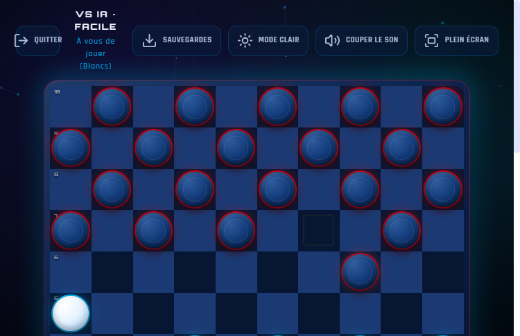
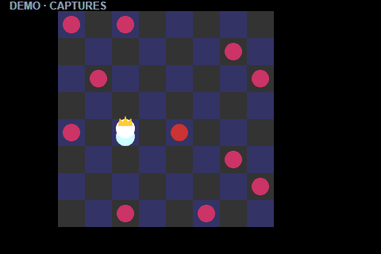

<div align="center">


# CHECKERS LEGEND 2026

### Le jeu de dames international qui enfreint les règles pour plus de fun — mais jamais votre vie privée.

**10×10 · IA locale · 100 % hors ligne · PWA & Android · Zéro serveur**

[](#démarrage)
[](#qualité--validation)
[](#qualité--validation)
[](#qualité--validation)
[](#pwa--android)
[](#licence)

[Démarrage](#démarrage) · [Fonctionnalités](#fonctionnalités) · [Aperçu](#aperçu) · [Règles](#règles--variantes) · [PWA / Android](#pwa--android) · [Validation](#qualité--validation)

</div>

<br>


---

## Pourquoi ce jeu ?

Les dames internationales, dans leur version la plus propre : **des règles officielles**, une **IA qui réfléchit sans bloquer l'écran**, une interface soignée qui tourne partout — et **aucune donnée qui quitte votre appareil**.

| | |
|---|---|
| ⚖️ **Règles officielles** | 10×10, prise obligatoire, rafles, prise majoritaire, dames volantes, promotion en fin de capture. |
| 🧠 **IA locale et réactive** | Minimax + Alpha-Bêta, table Zobrist, quiescence, 4 niveaux, exécutée dans un Web Worker. |
| ⚡ **Zéro blocage** | L'attente de l'IA est une fine barre en bas de l'écran, jamais une fenêtre qui cache le plateau. |
| 🎨 **Interface premium** | Palette rouge / bleu / cyan / blanc, deux thèmes, 4 plateaux, 4 styles de pions, animations et fond de particules réglable. |
| 💀 **Captures brutales** | Fissures, éclaboussures, onde de choc, flash plein écran et secousse du plateau ; en rafle, l'intensité monte et les « K.O. 💀 » s'enchaînent. |
| 🩸 **Mode carnage (option)** | Geyser de sang, flaques avec coulures, secousse et flash décuplés, et répliques macabres du coroner à chaque prise. Purement visuel, désactivé par défaut. |
| 👑🪓 **Décapitation des dames (option)** | La reine capturée perd la tête et sa couronne qui voltigent, avec jet de sang et répliques du genre « Off with her head! ». Fonctionne même sans carnage. |
| ⚔️ **Frappe royale** | Quand une **dame capture**, la pièce s'illumine, une lame dorée traverse le plateau et des étincelles jaillissent, avec des répliques du type « La dame fait des siens ! ». Toujours actif, aucune option à régler. |
| 📴 **Hors ligne par design** | Après le premier chargement, tout fonctionne sans Internet — IA comprise. |
| 🔒 **Confidentialité totale** | Aucun compte, aucune API, aucun traceur, aucun CDN. Vos parties restent chez vous. |

---

## Fonctionnalités

### Le jeu

- **Dames internationales 10×10** — 20 pions par camp, 50 cases jouables, Blancs au trait.
- **Promotion en fin de rafle** : un pion qui traverse la dernière rangée pendant une capture ne devient dame qu'à la fin de la séquence.
- **Dame volante** : déplacement et prise à distance sur les diagonales.
- **Deux dames empilées + couronne** pour une lisibilité immédiate sur le plateau.
- **Deux modes** : contre l'IA (choix de la couleur) ou à deux sur le même écran.
- **Quatre niveaux d'IA**, du facile à l'expert (recherche jusqu'à 12 coups).

### Le confort

- **3 sauvegardes manuelles** en plus de la reprise automatique : écraser, charger, supprimer.
- **Parties nommées** : enregistrez autant de parties que vous voulez sous un nom explicite.
- **Profils de joueurs** : paramètres, statistiques, XP et sauvegardes séparés pour chaque joueur.
- **Annulation intelligente** : remonte au dernier coup humain, y compris après la réponse de l'IA.
- **Copie de la notation** des coups en un clic depuis l'historique.
- **Chronomètres** 3 / 5 / 10 / 15 / 30 min ou illimités, pause, plein écran.
- **XP, niveaux, statistiques** et historique des 50 dernières parties avec rejouabilité.
- **Clavier** : Tab entre les cases jouables, Entrée/Espace pour jouer, flèches pour naviguer.
- **6 puzzles tactiques** : rafles, promotion, dames volantes, puzzle du jour, indices et XP.
- **Analyse de position** : l'IA locale recommande un coup directement dans la modale puzzle.
- **Progression des puzzles** conservée : puzzle en cours rouvert, résolus marqués d'un ✓.
- **Petit mot GitHub** au lancement, désactivable dans les paramètres.

### Variantes non réglementaires

Désactivées par défaut, regroupées dans **Paramètres → Options non réglementaires** (et expliquées dans *Comment jouer*) :

- **Prise non obligatoire** — un déplacement simple reste autorisé même si une capture existe.
- **Enchaîner les captures** — capturer donne un tour bonus, pour enchaîner les prises.

L'IA et les sauvegardes connaissent ces options ; les puzzles, eux, restent en règles officielles.

À part, **Paramètres → Massacre des dames 💀** (ambiance uniquement, désactivées par défaut) : **Mode carnage** (chaque prise explose en sang avec un commentaire du coroner) et **Décapiter les dames** (la reine capturée perd la tête et sa couronne, même sans carnage). Aucune règle, aucune probabilité de l'IA et aucun puzzle n'est affecté.

---

## Aperçu

<table>
  <tr>
    <td align="center"><b>Accueil</b><br></td>
    <td align="center"><b>Partie contre l'IA</b><br></td>
  </tr>
  <tr>
    <td align="center"><b>Mobile</b><br></td>
    <td align="center"><b>Hors ligne</b><br></td>
  </tr>
</table>

<p align="center">
  <b>Aperçu animé des captures (frappe royale · décapitation · carnage) :</b><br>
  
</p>

Le GIF est affiché sur l'accueil du jeu et fonctionne hors ligne. Il peut être régénéré avec `npm run gif`.

---

## Démarrage

Prérequis : **Node.js 20+**. Aucune installation de dépendances n'est nécessaire.

```bash
npm start
```

Ouvrez ensuite **http://127.0.0.1:8080**.

Sans npm :

```bash
node scripts/serve.js 8080
```

> Le serveur local fournit les bons types MIME et permet l'installation PWA. Sur **ordinateur**, ouvrir `index.html` en `file://` fonctionne aussi pour jouer, mais le Service Worker est désactivé par le navigateur ; l'IA bascule alors automatiquement sur le thread principal. Sur **Android**, utilisez plutôt le build autonome décrit plus bas.

```bash
npm test                  # 87 tests Node.js
npm run test:browser      # parcours navigateur headless (Edge/Chrome)
npm run test:browser:firefox # parcours Firefox 160+ via WebDriver BiDi, sans dépendance
npm run verify            # tests + intégrité PWA
npm run build:offline     # génère le fichier HTML unique pour Android
npm run gif                # régénère le GIF de démonstration (Edge/Chrome)
```

> **Sur Android, ne copiez pas seulement le dossier.** Ouvrir `index.html` en
> `file://` bloque le chargement des scripts et du CSS. Utilisez le build
> autonome ci-dessous, ou hébergez le site en HTTPS et installez la PWA.
> Guide complet : [`docs/ANDROID.md`](docs/ANDROID.md).

---

## Règles & variantes

<details>
<summary><b>Règles internationales implémentées</b></summary>

- Plateau 10×10, 50 cases sombres jouables, 20 pions par joueur, les Blancs commencent.
- Pions : déplacement diagonal avant d'une case, capture en avant **et** en arrière.
- **Prise obligatoire** et **prise majoritaire** : la rafle qui capture le plus de pièces est imposée.
- Prises multiples enchaînées jusqu'à épuisement ; une pièce déjà capturée reste bloquante pendant la rafle.
- **Dame volante** : courses et captures à distance sur les diagonales.
- **Promotion uniquement en fin de rafle**.
- Victoire : plus de pièces, adversaire bloqué ou chronomètre écoulé.
- Match nul : triple répétition ou 50 demi-coups sans progression.

</details>

Les règles ci-dessus sont le comportement **par défaut**. Les deux variantes présentées plus haut sont purement optionnelles.

---

## PWA & Android

**Copiez un fichier, ouvrez-le, jouez.** C'est tout.

1. Copiez **`dist/checkers-legend-offline.html`** sur votre téléphone.
2. Ouvrez-le avec **Chrome**.

Le jeu démarre immédiatement, **sans serveur, sans hébergement et sans APK à installer** :
aucune permission à accepter, aucune application verrouillée à côté du système, aucun compte.

- **100 % hors ligne** : le code, les styles, les polices, les images, les sons, l'IA et la sauvegarde sont déjà dans le fichier.
- **Sécurisé** : aucune donnée n'est envoyée, rien n'est téléchargé, tout reste sur l'appareil.
- **À jour** : le fichier est régénéré à chaque livraison avec `npm run build:offline`.

Le dossier `dist/` contient déjà la version prête à l'emploi pour smartphone :
**[télécharger `checkers-legend-offline.html`](https://github.com/Lud972vic/Jeu-de-dames/raw/main/dist/checkers-legend-offline.html)** (~1,4 Mo).

---

## Qualité & validation

La robustesse n'est pas un slogan : le moteur de règles est testé comme le code réellement exécuté par le jeu (modules UMD partagés navigateur / Worker / Node).

| Suite | Résultat |
|---|---|
| Tests Node.js (`npm test`) | **81 / 81** — règles, IA, stockage, particules, profils, puzzles, compatibilité WebKit, intégrité |
| Parcours navigateur (`npm run test:browser`) | **17 / 17 étapes**, 0 exception JavaScript (Edge/Chromium) |
| Parcours Firefox (`npm run test:browser:firefox`) | **11 / 11 étapes**, 0 exception (WebDriver BiDi intégré, zéro dépendance) |
| Intégrité PWA (`npm run verify`) | **✅ validée** — ressources locales, manifeste, précache, ordre de chargement |
| Hors ligne | IA, sauvegardes et statistiques vérifiés réseau coupé |

Détails complets : [`docs/TEST_REPORT.md`](docs/TEST_REPORT.md).

---

## Architecture

```text
index.html · style.css · script.js     Interface, thèmes, contrôleur
manifest.json · service-worker.js      PWA et cache hors ligne
config/game-config.js                  Constantes, difficultés, XP
js/game-rules.js                       Règles pures (10×10)
js/game-engine.js                      État, historique, annulation
js/ai-engine.js · ai-worker.js         Minimax, Zobrist, Web Worker
js/board-renderer.js                   Plateau, pièces, animations
js/{storage,settings,statistics,audio,animations}-manager.js
js/profile-manager.js                  Profils, registre et parties nommées
js/particles-background.js             Fond de particules canvas (thème adaptatif)
js/puzzles.js                          Puzzles tactiques et analyse de positions
assets/                                Polices, icônes, logo, sons WAV (locaux)
scripts/                               Serveur, tests Edge/Firefox, génération d'assets, build HTML unique
dist/                                  Build autonome généré par `npm run build:offline`
tests/                                 87 tests Node.js
docs/                                  Architecture, dépendances, rapports, captures
```

Aucun module n'a de dépendance distante à l'exécution. Le logo, les icônes et les sons sont régénérés localement par `node scripts/generate-assets.js`.

Documentation technique : [`docs/ARCHITECTURE.md`](docs/ARCHITECTURE.md) · [`docs/DEPENDENCY_REPORT.md`](docs/DEPENDENCY_REPORT.md) · [`PROJECT_STATUS.md`](PROJECT_STATUS.md) · [`docs/ANDROID.md`](docs/ANDROID.md)

**Vous débutez ou devez maintenir le projet ?** [`docs/GUIDE_DEBUTANT.md`](docs/GUIDE_DEBUTANT.md) explique les concepts JavaScript et l'organisation du code avec des mots simples. Chaque fonction du projet est commentée pour un lecteur qui ne connaît pas le langage.

---

## Confidentialité

Tout est conservé dans `localStorage` sous le préfixe `cl2026:` : paramètres, statistiques, profils et sauvegardes. **Aucune donnée n'est envoyée, synchronisée ou analysée.** Effacer les données du site supprime la progression. Les parties à deux joueurs ne modifient ni l'XP ni les statistiques personnelles.

---

## Licence

Code original sous licence **MIT**. Bootstrap (MIT), Lucide (ISC) et les polices Orbitron / Rajdhani (SIL OFL 1.1) restent la propriété de leurs auteurs.

<div align="center">

**CHECKERS LEGEND 2026** — beau, rapide, et jouable même sans réseau.

Fait par [Lud972vic](https://github.com/Lud972vic) · Dépôt : [Jeu-de-dames](https://github.com/Lud972vic/Jeu-de-dames)

</div>
