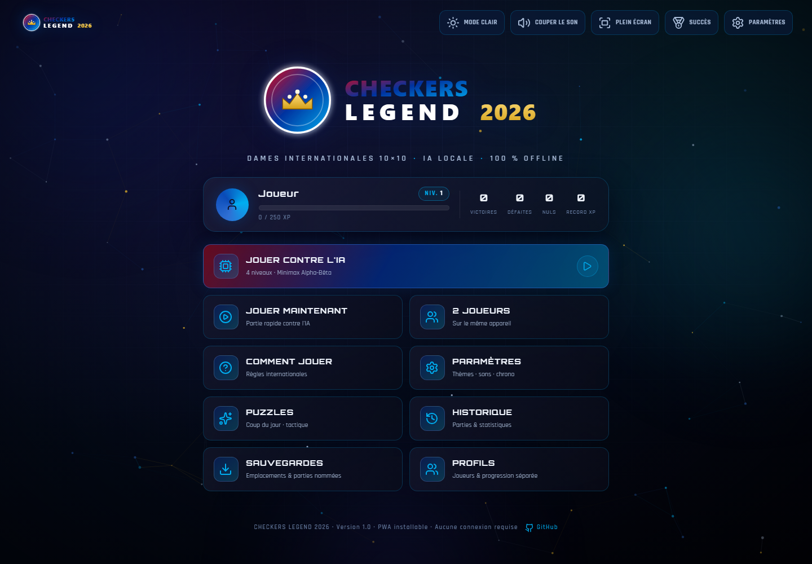
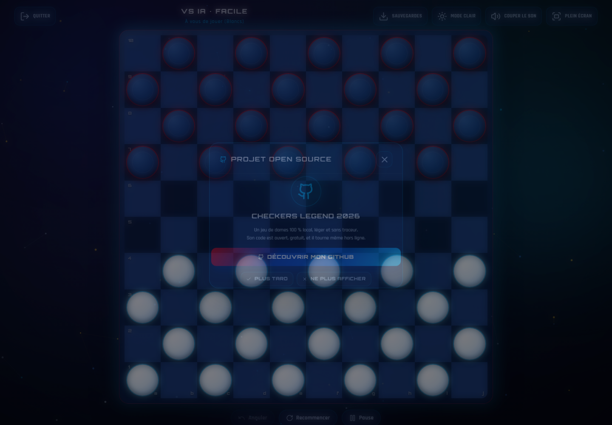
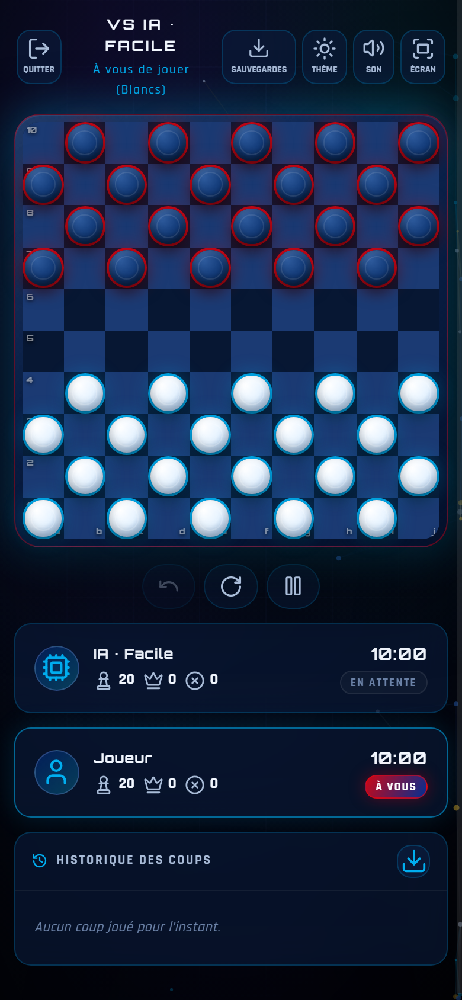

# CHECKERS LEGEND 2026

**Jeu de dames internationales 10×10 premium — 100 % local, 100 % hors ligne.**

Application HTML5 / CSS3 / JavaScript natif, sans CDN, sans API distante et sans cloud.
L'intelligence artificielle (Minimax + Alpha-Bêta) s'exécute entièrement sur votre machine,
dans un Web Worker pour ne jamais bloquer l'interface.



---

## Sommaire

- [Points forts](#points-forts)
- [Démarrage rapide](#démarrage-rapide)
- [Installation PWA et mode hors ligne](#installation-pwa-et-mode-hors-ligne)
- [Règles internationales implémentées](#règles-internationales-implémentées)
- [Modes de jeu et difficultés](#modes-de-jeu-et-difficultés)
- [Commandes et interface](#commandes-et-interface)
- [Architecture du projet](#architecture-du-projet)
- [Technologies et dépendances locales](#technologies-et-dépendances-locales)
- [Données locales et confidentialité](#données-locales-et-confidentialité)
- [Tests et validation](#tests-et-validation)
- [Compatibilité](#compatibilité)
- [Documentation](#documentation)
- [Licences](#licences)

---

## Points forts

| Domaine | Détails |
|---------|---------|
| **Règles complètes** | Damier 10×10, 20 pions par camp, prise obligatoire, prises multiples, prise majoritaire, dames volantes, promotion en fin de rafle. Les règles officielles restent le comportement par défaut ; deux variantes **non réglementaires** (prise non obligatoire, enchaînement des captures avec tour bonus) sont désactivées par défaut et activables dans les paramètres. |
| **IA locale** | Minimax + élagage Alpha-Bêta, tri des coups, table de transposition Zobrist, approfondissement itératif, recherche de quiescence, 4 niveaux. |
| **Aucun blocage** | Recherche dans un Web Worker dédié, avec repli automatique sur le thread principal si les Workers sont indisponibles (`file://`) ; l'attente de l'IA est signalée par une petite barre « L'IA réfléchit… » en bas d'écran (profondeur et nœuds explorés), sans modale bloquante. |
| **Interface premium** | Palettes sombre et clair inspirées du logo (rouge/bleu/cyan/blanc) : plateau et dame bleus, contours rouges sur les pièces noires, accents cyan, boutons et logo rouge/bleu/cyan. La dame est représentée par deux disques de pion empilés surmontés d'une couronne dorée. 4 thèmes, 4 styles de pièces, animations fluides, particules et confettis. |
| **Sons locaux** | 7 effets audio générés localement (WAV), volume réglable, coupure instantanée. |
| **Progression** | XP, niveaux, victoires/défaites/nuls, meilleur score, historique des 50 dernières parties. |
| **Confort** | Sauvegarde automatique + 3 emplacements manuels (sauvegarder/charger/supprimer), copie de la notation des coups, reprise de partie, annulation, pause, chronomètres 3/5/10/15/30 min ou illimité, plein écran. |
| **Accessibilité** | Plateau navigable au clavier : Tab pour parcourir les cases jouables, Entrée/Espace pour sélectionner et jouer, flèches pour se déplacer ; libellés ARIA sur les cases. |
| **PWA hors ligne** | Manifeste, icônes, Service Worker avec précache complet : le jeu fonctionne sans Internet après le premier chargement. |
| **Zéro réseau** | Aucune requête vers un service tiers, aucune police distante, aucun CDN (le seul lien externe est le profil GitHub du pied de page). |
| **Tests réels** | 60 tests automatisés Node.js + parcours navigateur headless de 15 étapes, hors ligne inclus. |



---

## Démarrage rapide

### Méthode recommandée (serveur local)

Prérequis : **Node.js 20 ou supérieur**.

```bash
npm start
```

Puis ouvrir **http://127.0.0.1:8080**.

Équivalent sans npm :

```bash
node scripts/serve.js 8080
```

Le serveur local fournit les bons types MIME, ce qui permet au Service Worker et à
l'installation PWA de fonctionner. Il n'ouvre aucune connexion vers l'extérieur.

### Ouverture directe

Vous pouvez aussi ouvrir `index.html` directement dans un navigateur. Le jeu fonctionne,
mais le Service Worker (donc le mode PWA hors ligne) est désactivé par sécurité sur
`file://`. Dans ce cas, l'IA bascule automatiquement du Web Worker vers le thread principal.

---

## Installation PWA et mode hors ligne

1. Lancez le serveur local (`npm start`) et ouvrez le jeu dans Chrome, Edge ou un navigateur compatible.
2. Utilisez le bouton d'installation de la barre d'adresse, ou le menu **« Installer l'application »**.
3. Après le premier chargement, le Service Worker met en cache **toutes** les ressources
   (HTML, CSS, JS, polices, sons, icônes).
4. Coupez Internet : le jeu, l'IA, les sauvegardes et les statistiques restent pleinement opérationnels.

Le serveur local est nécessaire pour l'installation PWA ; en production, tout hébergement
statique en HTTPS convient. Aucun serveur applicatif n'est requis.

---

## Règles internationales implémentées

- Damier de **10×10** cases, **50 cases jouables**, **20 pions par joueur**.
- Les **Blancs** commencent. Les pions blancs montent, les pions noirs descendent.
- Déplacement diagonal d'une case vers l'avant.
- **Prise obligatoire** : si une capture est possible, aucun mouvement simple n'est autorisé.
- **Prises multiples** avant et arrière, y compris pour les pions.
- **Prise majoritaire obligatoire** : la rafle capturant le plus de pièces doit être jouée.
- **Dame volante** : déplacement et prise à distance sur toute diagonale.
- Une dame ne peut pas sauter par-dessus une autre dame, ni capturer deux fois la même pièce.
- **Promotion uniquement à la fin de la rafle** : un pion qui traverse la dernière rangée
  pendant une capture ne devient dame qu'après la séquence complète.
- Fin de partie : plus de pièces, plus de coup légal, ou chronomètre écoulé.
- Match nul : **triple répétition** de la position ou **50 demi-coups** sans capture ni
  mouvement de pion (25 coups par joueur).
- Notation des coups et historique complet avec annulation.

**Les règles par défaut sont les règles officielles.** Toutes les règles ci-dessus
s'appliquent telles quelles au lancement d'une partie. Deux variantes **non
réglementaires** sont proposées à titre purement optionnel : elles sont désactivées
par défaut et regroupées dans la section « Options non réglementaires » des
paramètres (elles sont également décrites dans la modale « Comment jouer ») :

- **Prise non obligatoire** (`capturesOptional`) : les déplacements simples restent
  autorisés même lorsqu'une capture est possible ; la prise majoritaire ne s'applique
  que si l'on choisit de capturer.
- **Enchaîner les captures (tour bonus)** (`chainCaptures`) : capturer conserve le
  tour au lieu de le céder à l'adversaire, ce qui permet d'enchaîner les prises.

Ces options sont enregistrées dans les paramètres et transmises au moteur via
`ruleOptions` ; elles ne modifient en rien le comportement par défaut.

---

## Modes de jeu et difficultés

### Modes

- **Contre l'IA** : choix de la couleur (Blancs ou Noirs) et du niveau.
- **2 joueurs local** : deux joueurs se partagent le même écran ; le plateau s'oriente selon le réglage.

### Niveaux d'IA

| Niveau | Profondeur cible | Profondeur max | Temps indicatif | Particularités |
|--------|------------------|----------------|-----------------|----------------|
| Facile | 2 | 3 | 450 ms | Hasard contrôlé, sans table de transposition |
| Normal | 4 | 5 | 1,4 s | Table de transposition, léger hasard |
| Difficile | 6 | 7 | 3,2 s | Jeu déterministe |
| Expert | 10 | 12 | 8 s | Recherche approfondie, quiescence complète |

Le temps réel est plafonné par le temps restant au chronomètre. La recherche s'arrête
d'elle-même lorsque la profondeur maximale est atteinte, ce qui peut être plus rapide
que la limite indiquée.

Pendant la réflexion, l'IA n'affiche plus de modale bloquante : une petite barre
« L'IA réfléchit… » apparaît en bas de l'écran et indique la profondeur atteinte et le
nombre de nœuds explorés.

---

## Commandes et interface

### Souris / tactile

1. Touchez une pièce : ses coups légaux s'affichent.
2. Touchez une case cible : le coup est joué.
3. Touchez à nouveau la pièce sélectionnée pour annuler la sélection.

### Raccourcis clavier

| Touche | Action |
|--------|--------|
| `Échap` | Ferme la modale ouverte, sinon met la partie en pause |

### Boutons de partie

- **Annuler** : remonte au dernier coup du joueur (annule aussi la réponse de l'IA).
- **Pause / Reprendre** : fige le chronomètre et la recherche IA.
- **Recommencer** : nouvelle partie avec les mêmes réglages.
- **Quitter** : sauvegarde la partie et revient à l'accueil.

### Paramètres

Thème (Néon, Classique, Verre lumineux, Minuit bleu), style des pièces (Néon, Classique, Rubis, Émeraude),
niveau d'IA, durée, vitesse d'animation, temps de réflexion IA, volume, sons,
animations, affichage des coups légaux, orientation du plateau, plein écran et
réinitialisation.

La section **« Options non réglementaires »** regroupe deux variantes désactivées par
défaut : **Prise non obligatoire** (`capturesOptional`) et **Enchaîner les captures
(tour bonus)** (`chainCaptures`). Ces mêmes options sont expliquées dans la modale
« Comment jouer ». Tant qu'elles ne sont pas activées, les règles internationales
officielles s'appliquent.



---

## Architecture du projet

```text
JeuxDeDames/
├── index.html                  # Structure de l'interface (3 écrans, modales)
├── style.css                   # Thèmes, responsive, animations CSS
├── script.js                   # Contrôleur principal (jeu, IA, UI, sauvegardes)
├── manifest.json               # Manifeste PWA
├── service-worker.js           # Cache hors ligne et cycle de vie PWA
├── package.json                # Scripts npm (serveur, tests)
├── config/
│   └── game-config.js          # Constantes, difficultés, évaluation, XP
├── js/
│   ├── game-rules.js           # Règles internationales 10×10
│   ├── game-engine.js          # État, historique, annulation, répétition
│   ├── ai-engine.js            # Minimax + Alpha-Bêta, Zobrist, quiescence
│   ├── ai-worker.js            # Protocole Web Worker
│   ├── board-renderer.js       # Rendu du plateau et des pièces
│   ├── animations.js           # Particules, confettis, Canvas
│   ├── audio-manager.js        # Sons WAV locaux et volume
│   ├── storage-manager.js      # localStorage versionné
│   ├── settings-manager.js     # Paramètres persistants
│   └── statistics.js           # XP, niveaux, statistiques, historique
├── assets/
│   ├── fonts/                  # Orbitron + Rajdhani (woff2 locaux)
│   ├── icons/                  # 36 icônes SVG Lucide
│   ├── images/                 # Logo et icônes PWA 192/512
│   └── sounds/                 # 7 effets WAV générés localement
├── vendor/
│   └── bootstrap/              # Bootstrap 5.3.9 local (CSS + bundle JS)
├── scripts/
│   ├── serve.js                # Serveur HTTP local
│   ├── verify-project.js       # Vérification globale (tests Node.js)
│   ├── browser-smoke-test.js   # Parcours navigateur headless (CDP)
│   └── generate-assets.js      # Régénère icônes/logo/sons (palette rouge/bleu/cyan)
├── tests/
│   ├── test-rules.js           # 28 tests de règles et de parties complètes
│   ├── test-ai.js              # 11 tests de l'IA
│   ├── test-storage.js         # 11 tests stockage / paramètres / reprise
│   └── test-integrity.js       # 10 tests d'intégrité et PWA
├── docs/
│   ├── ARCHITECTURE.md         # Architecture technique détaillée
│   ├── DEPENDENCY_REPORT.md    # Vérification des dépendances locales
│   ├── TEST_REPORT.md          # Rapport de tests complet
│   └── screenshots/            # Captures de validation
└── PROJECT_STATUS.md           # État final du projet
```

Tous les modules JavaScript utilisent un motif UMD compatible navigateur,
Web Worker et Node.js (`require`), ce qui permet de tester exactement le code
exécuté dans le jeu.

Le logo, les icônes et les sons sont régénérés localement avec
`node scripts/generate-assets.js` ; ils reprennent la palette du logo
(rouge/bleu/cyan/blanc), également utilisée pour les palettes sombre et clair
du plateau et de l'interface.

---

## Technologies et dépendances locales

| Composant | Version | Emplacement | Licence |
|-----------|---------|-------------|---------|
| Bootstrap | 5.3.9 | `vendor/bootstrap/` | MIT |
| Lucide (icônes SVG) | 1.77.0 | `assets/icons/` | ISC |
| Orbitron | @fontsource 5.3.0 | `assets/fonts/` | SIL OFL 1.1 |
| Rajdhani | @fontsource 5.3.0 | `assets/fonts/` | SIL OFL 1.1 |
| Moteur de jeu / IA / UI | 1.0.0 | `js/`, `script.js` | MIT |

Aucune de ces dépendances n'est chargée depuis Internet à l'exécution.
Les détails de récupération et de vérification figurent dans
[`docs/DEPENDENCY_REPORT.md`](docs/DEPENDENCY_REPORT.md).

---

## Données locales et confidentialité

Tout est stocké dans le `localStorage` du navigateur, sous le préfixe `cl2026:` :

| Clé | Contenu |
|-----|---------|
| `cl2026:settings` | Paramètres et préférences |
| `cl2026:stats` | XP, niveau, statistiques et 50 dernières parties |
| `cl2026:savegame` | Partie en cours (reprise automatique) |

Aucune donnée n'est transmise, analysée ou synchronisée. Effacer les données du site
dans le navigateur supprime la progression. Les parties à 2 joueurs sont historisées
sans modifier les statistiques personnelles ni l'XP.

---

## Tests et validation

```bash
# Suite complète (60 tests Node.js)
npm test

# Tests navigateur headless (Edge ou Chrome requis)
npm run test:browser
```

Résultats de la version 1.0.0 (22 novembre 2026) :

- **60/60 tests Node.js réussis**, 0 échec (28 règles, 11 IA, 11 stockage, 10 intégrité).
  La commande `npm run verify` passe également.
- **14/14 étapes du parcours navigateur réussies**, y compris tous les réglages,
  le choix des Noirs, le repli sans Web Worker, le rechargement hors ligne et une
  partie d'IA complète sans réseau.
- **0 exception JavaScript** pendant le parcours.
- Performance IA mesurée : profondeur 12 en 2,18 s sur la position initiale (Expert).

Le détail des scénarios, des mesures et des captures est disponible dans
[`docs/TEST_REPORT.md`](docs/TEST_REPORT.md).

---

## Compatibilité

- **Navigateurs** : Chrome / Edge 120+, Firefox 120+, Safari 17+ (versions récentes recommandées).
- **Mobile** : interface responsive testée en 390×844 ; plateau et panneaux adaptés.
- **Web Worker** : utilisé lorsqu'il est disponible ; repli transparent sinon.
- **PWA** : installation et cache hors ligne via HTTP/HTTPS (localhost accepté).
- **Réduction des animations** : le réglage `prefers-reduced-motion` est respecté.

---

## Documentation

- [`docs/ARCHITECTURE.md`](docs/ARCHITECTURE.md) — conception technique, modules, protocoles et plan de tests.
- [`docs/DEPENDENCY_REPORT.md`](docs/DEPENDENCY_REPORT.md) — inventaire et vérification des dépendances locales.
- [`docs/TEST_REPORT.md`](docs/TEST_REPORT.md) — rapport de tests détaillé et reproductible.
- [`PROJECT_STATUS.md`](PROJECT_STATUS.md) — état final, fonctionnalités et limites connues.

---

## Licences

Le code original de CHECKERS LEGEND 2026 est distribué sous licence MIT.
Bootstrap est sous licence MIT, Lucide sous licence ISC, les polices Orbitron et
Rajdhani sous SIL Open Font License 1.1. Les textes de licence restent la propriété
de leurs auteurs respectifs.

---

**CHECKERS LEGEND 2026** — conçu pour être beau, rapide et jouable partout, même sans réseau.
# jeux-de-dames

